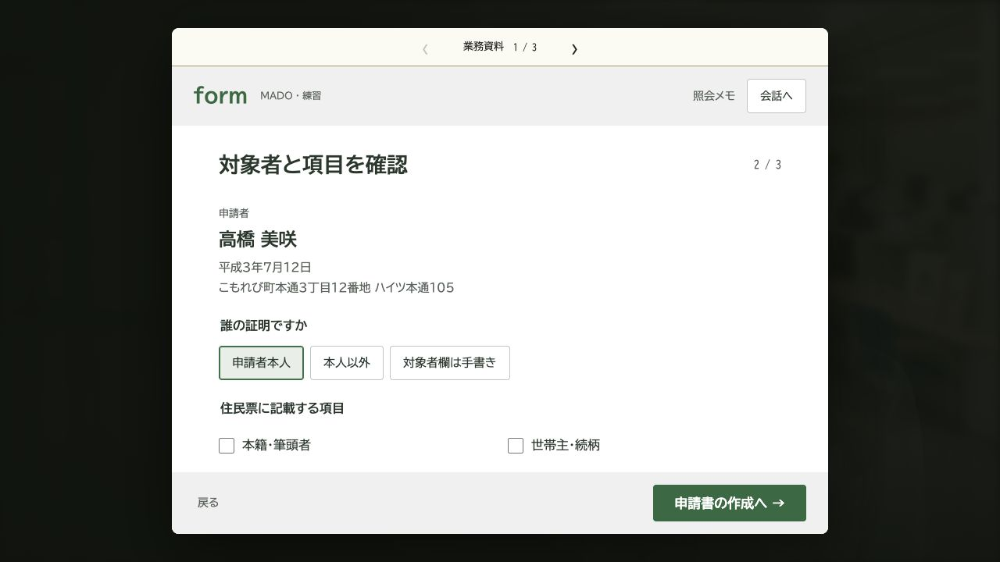

# 証明書窓口ドリル

自治体の「書かない窓口」を題材にした、ブラウザーで遊べる窓口応対ゲームです。新人職員として、来庁者の話を聞き、書類と申請内容を確かめます。

**[ブラウザーで遊ぶ](https://madoguchi-drill.pages.dev/)** · **v1.0.1** · 個人開発：[tocky8bit](https://github.com/rtoki)


北海道芽室町の[MADO](https://github.com/Memuro-Town/MADO)関連公開資料を参考にした、非公式のゲームです。キャプチャ内の人物・町・書類データは架空です。

| 通常モード | ストーリーモード |
| --- | --- |
| 本人確認・申請書作成・交付判断を練習。資料や先輩の助言を使いながら、窓口応対を進めます。 | 架空の町役場の一日を描く、全3章の幻想ミステリー。会話と記録を読み返し、出来事を確かめます。 |
|  |  |

## 遊び方

[公開サイト](https://madoguchi-drill.pages.dev/)で［通常モード］か［ストーリーモード］を選ぶと始められます。インストールは不要です。ダウンロードした場合は `game/index.html` をブラウザーで開けます。

- **文章送り**：クリック・タップ・Enter・Space。表示途中の操作は全文表示、読了後は次へ進みます。右下の大きな［次へ］ボタンでも操作できます。
- **資料・振り返り**：資料や設定はメニューから開けます。画面の時刻を押すとタイムラインを確認できます。
- **窓口端末**：部数は数字キーまたは画面の入力パッドで入力できます。パッドは電話と同じく上段が1・2・3です。［会話へ］で応対画面に戻ります。
- **採点・保存**：通常モードは正解100点、相談後の正解50点、誤答0点。ストーリーモードは途中保存から再開できます。
- **音・表示**：設定で文字速度、動き、音量を変更できます。右上のボタンで消音できます。環境音の初期設定はOFF、BGMの初期音量は50%です。

スマートフォンにも対応しています。音は最初のタップ等の後に再生を開始します。端末・ブラウザーの制限によっては静止画表示になります。保存は端末内で行い、実際のMADOや住民情報システムには接続しません。公開サイトと外部フォントへの通信はあります。

## 改変して動かす

Python 3・Node.js 20以上を用意し、リポジトリ直下から実行します。

```sh
cd game
npm ci
npm run typecheck
python3 scripts/build.py web
```

`game/index.html` に単体HTML、`game/web-dist/` に配信用ファイルが生成されます。プレイヤー向けのインストール作業はありません。

別作品の見本をビルドする場合は、`game/` で次を実行します。

```sh
python3 scripts/build.py standalone --scenario starter
```

出力先は `game/build/starter/` です。現在は1回のビルドで1作品を選ぶ構成です。シナリオの本文・設定はMarkdown・JSONで編集でき、対応するエンジン機能はTypeScriptで型チェックしてからJavaScriptへ変換します。一部の画面描画と作品固有の拡張はJavaScriptです。

| やりたいこと | 案内 |
| --- | --- |
| シナリオの改変・追加、素材の差し替え | [シナリオ追加・執筆ガイド](docs/SCENARIO-AUTHORING.md) |
| エンジンの変更、検証、版・セーブの互換性確認 | [AI向け作業ガイド](AGENTS.md) |
| 音楽・人物動画の構成を確認 | [音楽](game/audio/README.md)・[人物動画](game/motion/README.md) |
| 素材の利用条件を確認 | [適用範囲とクレジット例](LICENSING.md) |

共通処理は `game/engine/` にまとめています。文章送りは `game-reader.ts`、物語表示と保存は `family-reader.ts`、窓口処理は `counter-script.ts`、型定義は `contracts.d.ts` が編集先です。作品ごとの本文・設定は `game/scenarios/`、ビルド・検証は `game/scripts/` にあります。生成物を直接編集せず、正本を直して再ビルドしてください。原稿や設定には結末を含みます。

原作の本文・時刻を変更した場合は、通常ビルドの前に `python3 scripts/build.py manuscript` を実行します。公開前の検証手順は [作業ガイドの「ビルドと検証」](AGENTS.md#ビルドと検証)を参照してください。スマホ幅やNodeでの検証は、実機iPhone・Safariでの音声・動画再生確認とは区別します。

原作は **v1.0.1**、共通エンジン・starterは **v1.0.0**。版の正本は `game/engine/version.json` と各作品の `manifest.json` です。配信時は同じビルドの `_headers` を含めてください。拡張コードを含むシナリオパックは、信頼できる作者のものをレビューして組み込む前提で、隔離実行する仕組みではありません。

## ご意見・貢献について

不具合報告、改善案、プレイした感想は、このリポジトリの **Issues** へお寄せください。修正・改善の **Pull Request** も歓迎します。

- Issueには、再現手順と利用環境を添えてください。
- 大きな仕様変更や新機能は、着手前にIssueで方針をご相談ください。
- PRには、変更の目的と確認した内容を記載してください。

提案・PRの採否とマージは、作品の方向性・保守性・利用条件を踏まえてメンテナーが判断します。すべての提案やPRが採用されるとは限りません。

依存パッケージとGitHub Actionsは [Dependabot](.github/dependabot.yml) が毎週月曜19時（日本時間）に更新を確認し、PRを作成します。自動マージは行わず、内容を確認して採否を判断します。

公開リポジトリのPRでは、型チェック・ビルド・既存の自動検証を [GitHub Actions](https://github.com/rtoki/madoguchi-drill/actions) で実行します。CodeQLでコードを解析し、Dependency Reviewで依存変更に既知の脆弱性がないか確認します。秘密情報の検出とpush保護も有効にしています。自動検証は、実機での操作・音声・動画の確認に代わるものではありません。

## 題材と注意

本作は tocky8bit が個人として開発・公開したゲームです。作者が所属する組織とは関係なく、その見解や方針を示すものではありません。

本作のストーリーはフィクションです。登場する町・人物・団体・事件・出来事はすべて架空であり、北海道芽室町および同町の職員・住民・実際の出来事とは一切関係ありません。

教材は自治体ごとの運用を含み、全国共通の手続きや法令解釈を示すものではありません。実務では担当自治体の規程と上席の指示に従ってください。救命を含むゲーム内の描写は、実地講習や専門家の指導に代わるものではありません。

職員用PCは独自の模擬画面です。写真風素材はAI生成で、実在の住民の写真は使っていません。身分証画像は学習用の見本です。参考元と再現範囲は [第三者の出典・表示](docs/THIRD-PARTY-NOTICES.md)にまとめています。

## 謝辞

[MADO](https://github.com/Memuro-Town/MADO)を開発・公開し、窓口業務の設計や運用の知見を共有されている皆さまに感謝します。開発者tocky8bitは、MADOの取り組みを個人として応援しています。

## 利用条件

独自のコードは [MIT](LICENSE)、独自の物語・教材は **CC BY 4.0**。独自のAI生成画像・動画は保有する権利の範囲でCC BY 4.0とし、第三者の素材は元の条件を保持します。

[適用範囲とクレジット例](LICENSING.md)、[第三者の表示](docs/THIRD-PARTY-NOTICES.md)、[素材台帳](game/licenses/assets.json)を参照してください。ゲーム内の「このゲームについて」と[公開版の利用条件](https://madoguchi-drill.pages.dev/licenses.html)にも必要な表示を収録しています。
